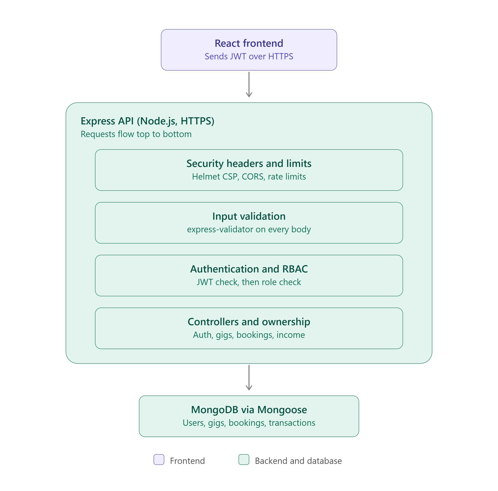

# HustleHub+

[](https://github.com/EMKNDW/insy7314-g1-2026-insy7314-2026-poe-st10266958/actions/workflows/ci.yml)

Secure freelance marketplace platform developed for INSY7214 (Secure Freelance Marketplace POE).

## Project Overview

HustleHub+ is a full-stack MERN application where **Freelancers** list services (gigs) and **Clients** browse and book them. Payments are simulated: every booking is confirmed immediately and creates a transaction record linked to both the client and the freelancer. The system tracks each freelancer's income from their bookings.

Security is treated as a core requirement. The platform handles user credentials and transaction records, so authentication, authorisation, input validation, rate limiting and security headers are applied across both the API and the frontend.

### Intended Users

| Role | Description |
|---|---|
| **Client** | Browses gigs, books them, and views their own bookings |
| **Freelancer** | Creates and manages their own gigs, views bookings made against them, and tracks income |
| **Admin** | Oversight role. Cannot be self-registered; created with a script. Views all users, gigs, bookings and transactions, and removes any gig, through the admin dashboard in the React app or the API. |

## Development Approach

The project is built incrementally across three parts:

- **Part 1 — Secure backend foundations** *(complete)*: Express API, HTTPS, registration, login, bcrypt hashing, JWT, validation
- **Part 2 — Secure stack** *(complete)*: MongoDB, gig management, bookings, transactions, income tracking, role-based access control, React frontend, security headers and CSP, Newman and frontend testing
- **Part 3 — DevSecOps, monitoring and finalisation** *(current)*: tax estimation and income charts, GitHub Actions CI/CD, static analysis, Docker and Docker Compose, structured logging and an audit trail, account lockout, final security review

## Features

- **Authentication:** register as a client or freelancer, log in, and receive a JWT
- **Gig management:** freelancers create, update, activate/deactivate and delete their own gigs. Anyone can browse active gigs.
- **Bookings:** clients book a gig and get a simulated confirmation. Every booking creates a transaction record associated with the client and the freelancer.
- **Income tracking:** freelancers see their total income and number of completed bookings
- **Tax estimation (Part 3):** an approximate South African income tax estimate for the current tax year, shown with a monthly income chart, a tax-versus-take-home chart and a step-by-step explanation
- **Logging and monitoring (Part 3):** login attempts, bookings, transactions, access denials, rate limiting and errors are logged to files and to a searchable audit trail that admins can query
- **Account lockout (Part 3):** repeated failed logins lock the account for a short time
- **DevSecOps (Part 3):** GitHub Actions pipeline (lint, security static analysis, tests, dependency audit, builds, full Docker smoke test) and a Docker Compose stack
- **Role-based access control:** each endpoint is restricted by role, and users can only modify or delete resources they own
- **Admin oversight:** an admin account (created with a script) can list all users, gigs, bookings and transactions and remove any gig, through the API or the admin dashboard
- **React frontend:** public gig browsing, registration and login, client booking flow and booking history, a freelancer dashboard (own gigs, bookings, income), and an admin dashboard (users, gigs, bookings, transactions, gig removal)

## Architecture

```
React frontend (Vite, http://127.0.0.1:5173)
        │   HTTPS, Authorization: Bearer <JWT>
        ▼
Express API (https://localhost:5000)
   Helmet + CSP → CORS → JSON body limit → rate limiter → input validation
   → JWT authentication → role check (RBAC) → controller (ownership check)
        │
        ▼
MongoDB via Mongoose: users, gigs, bookings, transactions, auditlogs

Logging: every request (morgan) and security event (audit helper) -> Winston -> logs/*.log
         security events also -> MongoDB AuditLog collection -> GET /api/admin/audit-logs
```

In Docker the same three tiers run as three containers on a private network (see [Docker](#docker-and-docker-compose)).

### Architecture diagram



## Technology Stack

| Layer | Technology |
|---|---|
| Frontend | React 18, React Router 6, Vite |
| Backend | Node.js, Express 5 |
| Database | MongoDB (Atlas), Mongoose |
| Security | JWT, bcrypt, express-validator, Helmet (CSP), express-rate-limit, CORS, HTTPS |
| Testing | Jest and Supertest (backend), Postman and Newman (API), Jest and React Testing Library (frontend) |
| DevSecOps | GitHub Actions, ESLint with eslint-plugin-security, CodeQL (public repos), `npm audit`, Dependabot |
| Containers | Docker (multi-stage, non-root), Docker Compose, nginx for the frontend |
| Logging | Winston (JSON log files with rotation), morgan, MongoDB audit collection |

## Project Structure

```
backend/
├── src/
│   ├── app.js                    Express app: security middleware, routes
│   ├── server.js                 Connects to MongoDB, then starts the HTTPS server
│   ├── config/                   env.js, db.js, httpsConfig.js, logger.js
│   ├── constants/                roles.js, bookingStatus.js, auditEvents.js
│   ├── controllers/              auth, gig, booking, income, admin
│   ├── middleware/               authMiddleware (JWT), rbacMiddleware (roles),
│   │                             validationMiddleware, rateLimiter, errorHandler, asyncHandler
│   ├── models/                   User, Gig, Booking, Transaction, AuditLog (Mongoose)
│   ├── routes/                   authRoutes, gigRoutes, bookingRoutes, incomeRoutes, adminRoutes
│   └── utils/                    AppError, jwt, password, audit, southAfricanTax
├── tests/                        Jest + Supertest tests (tax, auth, lockout, RBAC, bookings, audit)
├── Dockerfile, docker-entrypoint.sh
├── postman/                      Postman collections and Newman output
├── docs/                         Testing documentation, references, diagram
├── scripts/                      createAdmin.js (creates an admin account)
└── screenshots/                  Test evidence

frontend/
├── src/
│   ├── App.jsx, main.jsx         App shell and routes
│   ├── api.js, config.js         API client and API URL
│   ├── auth.jsx, components.jsx  Auth context, route guards, shared components
│   ├── pages/                    AuthPage, Gigs, GigDetail, Dashboard, IncomeInsights, Bookings, AdminDashboard
│   └── test/                     Test setup and CSP tests
├── csp.js, vite.config.js        Content Security Policy headers and Vite config
├── Dockerfile, nginx.conf.template   Production image (nginx serves the build and sends the CSP)
└── docs/                         Frontend testing and CSP documentation, evidence

.github/workflows/                ci.yml (pipeline), codeql.yml (CodeQL scan)
.github/dependabot.yml            Weekly dependency update pull requests
docker-compose.yml                MongoDB + backend + frontend
docker/mongo-init/                Creates the least-privilege database user
docs/evidence/                    Test, lint and audit output from Part 3
```

## API Endpoints

Base URL: `https://localhost:5000`. All protected routes need `Authorization: Bearer <token>`.

| Method | Endpoint | Access | Description |
|---|---|---|---|
| GET | `/health` | Public | Health check |
| POST | `/api/auth/register` | Public | Register as a client or freelancer |
| POST | `/api/auth/login` | Public | Log in and receive a JWT |
| GET | `/api/auth/profile` | Any logged-in user | Current user's profile |
| GET | `/api/gigs` | Public | List active gigs |
| GET | `/api/gigs/:id` | Public | Get one gig |
| GET | `/api/gigs/mine` | Freelancer | List your own gigs |
| POST | `/api/gigs` | Freelancer | Create a gig |
| PUT | `/api/gigs/:id` | Freelancer (owner) | Update a gig |
| DELETE | `/api/gigs/:id` | Freelancer (owner) | Delete a gig |
| POST | `/api/bookings` | Client | Book a gig; also creates a transaction |
| GET | `/api/bookings/client` | Client | Your bookings as a client |
| GET | `/api/bookings/freelancer` | Freelancer | Bookings made against your gigs |
| GET | `/api/income` | Freelancer | Total income, completed bookings, monthly income for the tax year and the tax estimate |
| GET | `/api/admin/users` | Admin | List all users (email, role and created date only) |
| GET | `/api/admin/gigs` | Admin | List all gigs, including inactive ones |
| GET | `/api/admin/bookings` | Admin | List all bookings |
| GET | `/api/admin/transactions` | Admin | List all transactions |
| DELETE | `/api/admin/gigs/:id` | Admin | Remove any gig |
| GET | `/api/admin/audit-logs` | Admin | Security audit trail. Optional filters: `event`, `outcome`, `limit` (1 to 200) |
| GET | `/api/admin/audit-logs/summary` | Admin | Count of audit events per type and outcome over the last 24 hours |

## Security Measures

### Password hashing
Passwords are hashed with bcrypt (12 salt rounds by default) before storage and are never stored or logged in plain text. Registration enforces 8 to 128 characters with at least one lowercase letter, one uppercase letter and one number.

### JWT authentication
Login returns a signed JWT with an expiry (1 hour by default). Every protected route passes through `authMiddleware`, which verifies the signature and expiry. Missing, malformed, wrongly signed and expired tokens are all rejected with `401`, and none of the messages reveal how the token is built.

### Role-based access control and ownership
`rbacMiddleware` restricts each route to specific roles and runs before the controller. A role mismatch returns `403`.

| Action | Client | Freelancer | Admin | Not logged in |
|---|---|---|---|---|
| Browse gigs | Yes | Yes | Yes | Yes |
| Create, update, delete gigs | No (403) | Own gigs only | No (403) | No (401) |
| Remove any gig | No (403) | No (403) | Yes | No (401) |
| Create a booking | Yes | No (403) | No (403) | No (401) |
| View own bookings | Client view | Freelancer view | No (403) | No (401) |
| View income | No (403) | Yes | No (403) | No (401) |
| View all users, gigs, bookings and transactions | No (403) | No (403) | Yes | No (401) |

Ownership is enforced in the controller. Editing or deleting a gig you do not own returns `404 Gig not found`, the same response as a gig that does not exist, so error messages cannot be used to discover which gig ids belong to other users. Registration only accepts the `client` and `freelancer` roles, so a user cannot create an admin account. Admin accounts are created with `npm run create-admin`, and every gig an admin removes is written to the server log. The admin user list never includes password hashes.

### Input validation and sanitisation
All request bodies are validated with express-validator before reaching any controller: email format (normalised), password strength, gig field types and length limits, price as a number, `isActive` as a boolean, and booking `gigId` as a valid MongoDB id. Values must be the expected type, so object payloads such as `{"$ne": null}` are rejected with `400` before any database query runs. JSON bodies are limited to 10 KB. On the frontend, React escapes all rendered text and the UI never injects user-supplied HTML.

### Rate limiting
Limits are applied per IP address.

| Endpoints | Limit |
|---|---|
| `POST /api/auth/register`, `POST /api/auth/login` | 20 requests per 15 minutes |
| `POST /api/bookings` | 30 requests per 15 minutes |

Exceeding a limit returns `429` with a clear message.

### Security headers and Content Security Policy
The API uses Helmet with an explicit Content Security Policy (`default-src 'self'`, `script-src 'self'`, `object-src 'none'`, `frame-ancestors 'none'`, and images limited to self and data URLs). The frontend sends its own CSP headers from the Vite dev and preview servers, with a strict production-preview policy. The headers are not part of the static build, so a production host must send them itself. In Docker, the nginx container does this (`frontend/nginx.conf.template`). See [`frontend/docs/frontend-csp.md`](frontend/docs/frontend-csp.md).

### HTTPS and CORS
The API runs over HTTPS with a locally generated certificate, so credentials and tokens are encrypted in transit. CORS only allows the configured `CLIENT_ORIGIN`.

### Safe error handling
Errors go through a central handler that returns clean JSON messages. Stack traces, file paths, database errors and configuration values are never sent to the client. Login failures return the same message whether the email or the password was wrong. The frontend maps API errors to readable messages and never shows raw responses.

### Frontend session handling
The JWT is held in React memory only, never in localStorage or sessionStorage, so refreshing the page ends the session. Route guards redirect anonymous and wrong-role users, but they exist for usability only. The real enforcement is on the server.

## Tax Estimation

Freelancers see an estimate of the income tax on their HustleHub+ earnings on the dashboard (`GET /api/income`, shown by `frontend/src/pages/IncomeInsights.jsx`). The calculation lives in [`backend/src/utils/southAfricanTax.js`](backend/src/utils/southAfricanTax.js) and uses the SARS tables for the 2026/27 tax year (1 March 2026 to 28 February 2027).

### How the estimate works

1. **Year-to-date income.** The server adds up the freelancer's completed transactions created in the current tax year. Only the freelancer's own transactions are included.
2. **Annualise.** Income so far is divided by the fraction of the tax year that has passed, to project a full year. If 50% of the year has passed and the freelancer earned R150,000, the projected annual income is R300,000.
3. **Apply the progressive brackets** to the projected annual income.
4. **Subtract the primary rebate** (R17,820, for taxpayers under 65). Tax cannot go below zero, so income under about R99,000 a year produces no tax.
5. **Prorate back** to the part of the year that has passed, to give "estimated tax so far" and "after-tax income".

| Taxable income (R) | Rate |
|---|---|
| 1 to 245,100 | 18% |
| 245,101 to 383,100 | R44,118 + 26% above 245,100 |
| 383,101 to 530,200 | R79,998 + 31% above 383,100 |
| 530,201 to 695,800 | R125,599 + 36% above 530,200 |
| 695,801 to 887,000 | R185,215 + 39% above 695,800 |
| 887,001 to 1,878,600 | R259,783 + 41% above 887,000 |
| 1,878,601 and above | R666,339 + 45% above 1,878,600 |

**Worked example.** Projected annual income R300,000: R245,100 x 18% = R44,118, plus R54,900 x 26% = R14,274, giving R58,392. Minus the R17,820 rebate gives R40,572 a year, an effective rate of 13.52%. If half the year has passed, the estimate so far is R20,286.

The tests in [`backend/tests/tax.test.js`](backend/tests/tax.test.js) check the calculation against published SARS worked examples (R240,000 gives R25,380; R360,000 gives R56,172; R500,000 gives R98,417).

### Assumptions and limits

The estimate ignores other income, business expenses and deductions, medical tax credits, retirement contributions, age rebates and provisional tax payments, and it is less reliable early in the tax year because a small amount of income is scaled up to a full year. The dashboard says so next to the figures. The brackets and rebate must be updated each year in `TAX_YEAR` and `TAX_BRACKETS`.

### What the freelancer sees

- Summary cards: income this tax year, estimated tax so far, after-tax income, projected annual income, projected annual tax and effective tax rate
- A bar chart of income per month (March to February) and a bar showing how much of the income is set aside for tax
- A four-step explanation of the calculation and a table of the brackets that apply
- An empty state when no income has been recorded yet

The charts are plain SVG. No chart library is used, so the strict Content Security Policy (`script-src 'self'`, `style-src 'self'`) is not weakened. Each chart has a text description for screen readers.

## Logging and Monitoring

### What is logged

Events are written as JSON by Winston to `logs/combined.log` (everything), `logs/error.log` (errors only) and `logs/audit.log` (security events only). Files rotate at 5 MB and the last 5 are kept. Security events are also stored in the MongoDB `auditlogs` collection, which admins can query.

| Category | Event | Logged when | Level |
|---|---|---|---|
| Login attempts | `auth.login.success` | A user logs in | info |
| | `auth.login.failed` | Unknown email or wrong password (with the reason and the attempt count) | warn |
| | `auth.login.blocked` | A login is refused because the account is locked | warn |
| | `auth.account.locked` | The failed-login limit is reached | warn |
| | `auth.register` | A new account is created | info |
| Bookings | `booking.created` | A client books a gig (booking id, gig id, amount) | info |
| | `booking.rejected` | Booking a missing gig or your own gig | warn |
| Transactions | `transaction.recorded` | A transaction is created for a booking (transaction id, amount, status) | info |
| Gigs and admin | `gig.created`, `gig.updated`, `gig.deleted`, `admin.gig.removed` | A gig changes, including admin removals | info |
| Access control | `auth.token.rejected` | A missing, malformed, forged or expired token (reason recorded) | warn |
| | `access.denied` | A user calls an endpoint their role is not allowed to use | warn |
| Abuse | `security.rate_limited` | A client is throttled by a rate limiter | warn |
| Errors | `Request error` | Any error handled by the central error handler (message, stack, path, status) | error for 5xx, warn for 4xx |
| | `Unhandled promise rejection`, `Uncaught exception` | Anything that escapes normal handling | error |
| Traffic | HTTP access log | Every request (method, path, status, size) through morgan | info |

Each security event records the event name, outcome (`success`, `failure` or `denied`), user id, email where relevant, IP address, user agent, HTTP method, path and event details.

### What is never logged

Passwords, password hashes and tokens are never written. A redaction step in `backend/src/config/logger.js` replaces any metadata field whose name contains `password`, `token`, `secret`, `authorization` or `hash` with `[REDACTED]`, as a safety net in case a developer logs a whole object by mistake. Stack traces go to the log files only, never to the client.

### Why these logs matter

- **Detecting attacks.** Many `auth.login.failed` events for one email suggest a brute-force attack. Many different emails from one IP suggest credential stuffing. `auth.account.locked` and `security.rate_limited` show that the defences are being triggered.
- **Spotting probing.** Repeated `access.denied` and `auth.token.rejected` events show someone trying other users' endpoints or forged tokens.
- **Accountability for money.** `booking.created` and `transaction.recorded` give a trail of who booked what and for how much, which supports dispute handling and detecting tampering.
- **Reliability.** Error logs with stack traces let the team find and fix faults without exposing them to users.
- **Incident response.** The audit trail answers who did what, when and from where after an incident.

### Viewing the logs

```bash
# Files (in Docker)
docker compose exec backend tail -n 20 logs/audit.log
docker compose logs backend

# Admin API (needs an admin token)
GET /api/admin/audit-logs?event=auth.login.failed&limit=20
GET /api/admin/audit-logs/summary
```

### Privacy and retention

Emails and IP addresses are personal information. Audit entries in MongoDB expire automatically after 90 days (`AUDIT_RETENTION_DAYS`) and are readable by admins only. Failed-login events record the email that was typed, which is needed to spot attacks.

## Additional Security Features

Part 3 adds two functional security features beyond the minimum requirements, plus supporting hardening.

### 1. Account lockout

Rate limiting works per IP address. Account lockout works per account, so an attacker who rotates IP addresses still cannot keep guessing one user's password.

- After **5** failed logins (`LOCKOUT_MAX_ATTEMPTS`) the account is locked for **15 minutes** (`LOCKOUT_MINUTES`).
- While locked, the API answers `429` and does not even check the password, so a correct guess does not reveal anything during the lock.
- A successful login resets the counter. The counter is incremented atomically in MongoDB (`$inc`), so parallel guesses are counted correctly.
- Every failure, lock and blocked attempt is written to the audit trail.
- **Trade-off:** the `429` for a locked account confirms that the email exists. This is accepted because the same information is not available for non-existent emails, which still receive the generic `401`, and the lock itself is the stronger protection. A real product would also notify the owner by email.
- Tested in `backend/tests/auth.test.js` and `backend/tests/userModel.test.js`.

### 2. Persistent audit trail with admin monitoring

Security events are stored in MongoDB and exposed to admins through `GET /api/admin/audit-logs` and `GET /api/admin/audit-logs/summary` (see [Logging and Monitoring](#logging-and-monitoring)). The filters are whitelisted (`event` must be a known event, `outcome` one of four values, `limit` 1 to 200), so nothing user-controlled reaches the database query. Entries expire automatically. Audit writes never throw, so a database problem cannot break a request. Tested in `backend/tests/admin.test.js` and `backend/tests/audit.test.js`.

### Supporting hardening

- **Strong secret enforced in production.** The API refuses to start with `NODE_ENV=production` and a `JWT_SECRET` shorter than 32 characters.
- **Least-privilege database user.** In Docker the API connects with a user that has `readWrite` on the `hustlehub` database only, not the MongoDB root account. MongoDB is not published to the host.
- **Hardened containers.** The API and frontend containers run as non-root users, use multi-stage builds with only production dependencies, and carry health checks.
- **Production CSP for the frontend.** The nginx image sends the same strict Content Security Policy and security headers as the Vite preview server.
- **Request body errors.** Oversized or malformed JSON now returns a clean `413` or `400` instead of a generic `500` (found while writing tests).
- **Malformed ids.** `GET`, `PUT` and `DELETE /api/gigs/:id` validate the id and return `400`. This fixes the known Part 2 issue where `/api/gigs/abc` returned `500`.
- **Dependency monitoring.** Dependabot opens weekly update pull requests, and the pipeline fails on high or critical vulnerabilities in production dependencies.

## Final Security Review

This section reviews how the finished system handles the common threats (aligned with the OWASP Top 10) and what risk remains.

| Threat | How HustleHub+ addresses it | Evidence |
|---|---|---|
| **Injection (NoSQL)** | Every body, parameter and query value is validated with express-validator for type and shape before it reaches a controller. Object payloads such as `{"$ne": null}` are rejected with `400`. Mongo ids are checked with `isMongoId`. Mongoose casts values to the schema types. Audit filters are whitelisted. There is no raw query building, no `$where`, no eval and no shell commands. | `auth.test.js` (operator payload rejected), `admin.test.js` (filter whitelist), `access.test.js` (non-id `gigId`, malformed id), ESLint `no-eval`/`no-new-func` rules |
| **Log injection** | Logs are structured JSON, so user input cannot forge new log lines, and the `morgan` package was updated to a version that fixes its log-injection advisories. | `npm audit` evidence |
| **Cross-site scripting (XSS)** | React escapes all rendered text, and the code never uses `dangerouslySetInnerHTML` (ESLint rule `react/no-danger` is an error). The frontend CSP allows scripts and styles from `'self'` only, with no inline scripts and no `eval`, and forbids framing. The JWT is held in memory, not in `localStorage`, so an XSS bug could not read it from storage. The API returns JSON only, with `X-Content-Type-Options: nosniff`. | `csp.test.js`, `security.test.js`, `access.test.js`, nginx headers |
| **Authentication weaknesses** | bcrypt (12 rounds) hashing, password rules (8 to 128 characters, mixed case, number), signed JWTs with issuer check and 1-hour expiry, identical error for unknown email and wrong password, rate limiting (20 per 15 minutes per IP), **account lockout**, no self-registration as admin, and a minimum secret length in production. | `auth.test.js`, `userModel.test.js`, `rateLimit.test.js` |
| **Broken access control** | Every protected route runs `requireAuth` then `requireRole`. Ownership is checked in the controller, and another user's gig returns the same `404` as a missing one, so ids cannot be probed. Booking amounts come from the gig price in the database, never from the request. Controllers copy named fields only, so a client cannot set `role`, `freelancer` or `amount` by adding extra fields. Income is always computed for the logged-in freelancer. | `access.test.js` (10 role checks, 4 missing-token checks, ownership), Newman collection |
| **Sensitive data exposure** | HTTPS for the API. Password hashes are never returned. Admin lists select `email role createdAt` only. Error responses are generic and stack traces are never sent. Secrets live in environment variables and `.env`, `*.pem` and logs are in `.gitignore`. Secrets and tokens are redacted from logs. | `auth.test.js` (no hash in response), `audit.test.js` (redaction) |
| **Security misconfiguration** | Helmet and CSP on the API, a strict CSP on the frontend, CORS limited to one origin, a 10 KB body limit, non-root containers, MongoDB not exposed, no default credentials (Compose refuses to start without them), and `x-powered-by` removed. | `security.test.js`, `docker-compose.yml` |
| **Vulnerable components** | `npm audit` runs in the pipeline and fails on high or critical production vulnerabilities. Dependabot proposes updates weekly. In Part 3 the audit found 5 vulnerabilities in the API's production dependencies (1 critical, 1 high) and all were fixed. | [`docs/evidence/npm-audit-backend-before.txt`](docs/evidence/npm-audit-backend-before.txt), [`npm-audit-backend-after.txt`](docs/evidence/npm-audit-backend-after.txt) |
| **Logging and monitoring failures** | Login attempts, bookings, transactions, access denials, rate limiting and errors are logged, stored in an audit trail and queryable by admins. | [Logging and Monitoring](#logging-and-monitoring) |
| **Denial of service** | Per-IP rate limits on authentication and booking, a body size limit, a limit of 200 rows on admin lists and 200 on audit queries. | `rateLimit.test.js`, `security.test.js` |
| **CSRF** | Authentication uses a bearer token in the `Authorization` header, which the browser does not attach automatically, and CORS allows one origin. No cookies are used for authentication, so classic CSRF does not apply. | Design |

### Evaluating the controls

The tests exercise each control and check the audit trail: for example a forged token, an expired token, a client calling a freelancer endpoint and the 21st login in a window each produce the expected status code and the matching audit event. This shows that the controls both block the attack and leave evidence for monitoring.

### Residual risks

- **No token revocation.** A stolen token works until it expires (1 hour). A refresh-token flow with a deny list would fix this.
- **No multi-factor authentication or email verification.**
- **Payments are simulated**, and booking plus transaction are two separate writes, so a failure between them could leave a booking without a transaction. A real system would use a replica set and a database transaction.
- **Static analysis scope.** ESLint with the security plugin finds code-level problems but is not a full data-flow analyser. CodeQL adds that where the repository is public.
- **Local certificate.** The Docker stack uses a self-signed certificate, so browsers must be told to trust it. A deployed system would use a certificate from a public authority and sit behind a reverse proxy.
- **Tax figures are estimates**, not advice.

## CI/CD Pipeline

The pipeline is [`.github/workflows/ci.yml`](.github/workflows/ci.yml). It runs automatically on every push and on pull requests, and any failing step fails the run.

| Job | Steps |
|---|---|
| **Backend** | Install (`npm ci`), ESLint security analysis (fails on any finding), Jest tests with coverage thresholds, `npm audit` for production dependencies (fails on high or critical), application build check, upload the coverage report |
| **Frontend** | Install, ESLint security analysis, Jest tests with coverage, `npm audit`, production build (`vite build`), upload the build |
| **Static analysis report** | Runs ESLint in both projects, saves the JSON results as an artifact and prints a summary table on the run page |
| **Docker** (after backend and frontend pass) | Builds both images, starts the whole stack with Docker Compose, waits for all health checks, and smoke-tests the API (`/health`) and the frontend (page and CSP header) |

A separate workflow, [`codeql.yml`](.github/workflows/codeql.yml), runs GitHub CodeQL on pushes to the main branch and weekly, when the repository is public. [`dependabot.yml`](.github/dependabot.yml) keeps dependencies, Dockerfiles and the actions themselves up to date.

Pipeline evidence (screenshot of a green run, the failing-run demonstration and the job summary) is in [Demonstration Evidence](#demonstration-evidence).

## Static Code Analysis

**Tool:** ESLint 9 with `eslint-plugin-security` (and `eslint-plugin-react` and `react-hooks` for the frontend), run on both projects in the pipeline. Extra rules make `eval`, `new Function` and `dangerouslySetInnerHTML` errors. CodeQL runs in addition when the repository is public.

**Results.** The raw output before review is in [`eslint-backend-raw.txt`](docs/evidence/eslint-backend-raw.txt) and [`eslint-frontend-raw.txt`](docs/evidence/eslint-frontend-raw.txt) (produced with inline suppressions switched off). It reported **0 errors and 18 warnings** (6 in the backend, 12 in the frontend). Every warning was reviewed:

| Rule | Count | Where | Verdict |
|---|---|---|---|
| `detect-object-injection` | 1 in `env.js`, 1 in `logger.js` | `process.env[name]` where `name` is a literal in the same file, and the log redaction loop over the log entry's own keys | False positive. No user input chooses the key. |
| `detect-object-injection` | 11 in the frontend (9 in the `AuthPage` and `Dashboard` forms, 2 in `validation.js`) | `errors[name]` in the forms, and lookups in the validation helpers, where the key is a field name written in the code (`title`, `price`), a literal (`'gigs'`) or an entry of a fixed list | False positive. Keys never come from typed text. |
| `detect-non-literal-fs-filename` | 4 in `httpsConfig.js` | Reading the TLS key and certificate from paths set in `.env` | Accepted. The path is server configuration, never a request value. |
| `detect-unsafe-regex` | 1 in `validation.js` | `^\d+(?:\.\d{1,2})?$` for prices | False positive. The pattern is linear, with no nested repetition, so it cannot cause catastrophic backtracking. |

Each accepted warning is suppressed inline with a written reason, so the pipeline now reports **0 errors and 0 warnings** and fails if a new finding appears ([`eslint-backend-final.txt`](docs/evidence/eslint-backend-final.txt), [`eslint-frontend-final.txt`](docs/evidence/eslint-frontend-final.txt)). What the results indicate: the code contains no use of `eval`, no raw query building, no unsafe HTML injection and no risky regular expressions, and the only flagged patterns are configuration-driven.

**Dependency analysis (`npm audit`).** Before Part 3 the API's production dependencies had 5 known vulnerabilities (1 critical in `proxy-addr`, 1 high in `body-parser`, 3 moderate in `ip-address`, `morgan` and `qs`). `npm audit fix` updated them and the audit now reports 0 ([before](docs/evidence/npm-audit-backend-before.txt), [after](docs/evidence/npm-audit-backend-after.txt)). The frontend audit reports 2 moderate findings in `react-router`, in its server-side-rendering code path that this client-only app does not use. Fixing it needs a major-version upgrade, so it is accepted for now and the pipeline gate is set to high ([evidence](docs/evidence/npm-audit-frontend.txt)).

## Docker and Docker Compose

The stack has three containers on a private network:

| Service | Image | Port | Notes |
|---|---|---|---|
| `mongo` | `mongo:7` | none (internal only) | Auth enabled, data in a named volume, creates a least-privilege app user on first start |
| `backend` | built from `backend/Dockerfile` | 5000 (HTTPS) | Node 22 Alpine, production dependencies only, non-root, creates a self-signed certificate on first start, health check on `/health`, logs in a volume |
| `frontend` | built from `frontend/Dockerfile` | 8080 (HTTP) | Vite build served by non-root nginx, strict CSP and security headers |

### Run it

Requirements: Docker Desktop (or Docker Engine with the Compose plugin).

```bash
cp .env.docker.example .env          # then edit the passwords and JWT_SECRET
# generate a secret:  openssl rand -hex 32
docker compose up --build
```

On Windows PowerShell use `Copy-Item .env.docker.example .env`. Keep database passwords free of characters that need URL encoding (`@ : / ? #`).

1. Wait until `docker compose ps` shows all three services as `healthy`.
2. Open **https://localhost:5000/health** once and accept the self-signed certificate warning. The frontend cannot call the API until this is done.
3. Open **http://localhost:8080**.

Create an admin account:

```bash
docker compose exec -e ADMIN_EMAIL=admin@example.com -e ADMIN_PASSWORD='ChangeMe123' backend npm run create-admin
```

Stop with `docker compose down` (add `-v` to delete the database and log volumes).

If you change `CLIENT_ORIGIN` or the API address, rebuild with `docker compose up --build` because the frontend bakes the API address into the bundle.

### Troubleshooting

- *"Set JWT_SECRET in .env"* means the root `.env` is missing or incomplete. Compose refuses to start without secrets by design.
- *"Cannot reach the API"* in the browser: trust the certificate (step 2) and check that `CLIENT_ORIGIN` matches the address in the address bar exactly.
- Backend exits with an authentication error against MongoDB: the database volume was created with older credentials. Run `docker compose down -v` and start again.


## Getting Started

The quickest way to run everything is [Docker Compose](#docker-and-docker-compose). The steps below set up the backend and frontend by hand for development.

Requirements: Node.js 20.19+ or 22.12+, OpenSSL, and a MongoDB database (a free MongoDB Atlas cluster works).

Each team member needs their own `.env` file and SSL certificate. These are excluded from the repository by `.gitignore` so no secrets are committed.

### 1. Clone

```bash
git clone https://github.com/EMKNDW/insy7314-g1-2026-insy7314-2026-poe-st10266958.git
cd insy7314-g1-2026-insy7314-2026-poe-st10266958
```

### 2. Backend

```bash
cd backend
npm install
```

Create `backend/.env` (copy `.env.example` and add the missing values):

| Variable | Required | Description |
|---|---|---|
| `MONGODB_URI` | Yes | MongoDB connection string, e.g. `mongodb+srv://<user>:<password>@<cluster>/hustlehub?retryWrites=true&w=majority` |
| `JWT_SECRET` | Yes | Any string for local development |
| `JWT_EXPIRES_IN` | No | Token lifetime, default `1h` |
| `BCRYPT_SALT_ROUNDS` | No | Default `12` |
| `PORT` | No | Default `5000` |
| `CLIENT_ORIGIN` | Yes | Frontend origin allowed by CORS. Set it to `http://127.0.0.1:5173`, the address Vite serves |
| `SSL_KEY_PATH`, `SSL_CERT_PATH` | No | Default `certificates/privatekey.pem` and `certificates/certificate.pem` |

If you use Atlas, create a database user and allow your IP address under Network Access, otherwise the server cannot connect and will not start.

Generate a local SSL certificate:

```bash
mkdir certificates
openssl req -x509 -newkey rsa:2048 -keyout certificates/privatekey.pem -out certificates/certificate.pem -days 365 -nodes -subj "/CN=localhost"
```

Start the API:

```bash
npm run dev
```

You should see "Connected to MongoDB" followed by the HTTPS startup message. Open `https://localhost:5000/health` once and accept the browser's self-signed certificate warning. The frontend cannot reach the API until the certificate is trusted.

### 3. Frontend

In a second terminal:

```bash
cd frontend
npm ci
npm run dev
```

Open **http://127.0.0.1:5173**, the address Vite prints in the terminal. It must match `CLIENT_ORIGIN` in `backend/.env`. The API URL defaults to `https://localhost:5000/api`. To change it, copy `frontend/.env.example` to `frontend/.env`, edit `VITE_API_URL`, and restart Vite.

If the app shows "Cannot reach the API", check that the backend is running, that its certificate is trusted, and that `CLIENT_ORIGIN` matches the address in your browser exactly (`localhost` and `127.0.0.1` count as different origins).

### 4. Admin account (optional)

The admin role cannot be created through the app. From the `backend` folder, with `.env` set up as above, run:

```powershell
$env:ADMIN_EMAIL="admin@example.com"
$env:ADMIN_PASSWORD="<a strong password>"
npm run create-admin
```

On macOS or Linux: `ADMIN_EMAIL=admin@example.com ADMIN_PASSWORD='<a strong password>' npm run create-admin`

The password must meet the same rules as registration. Sign in through the React app (you are taken to `/admin`), or use `POST /api/auth/login` to get an admin token for Postman. Use a throwaway password, never a real one.

## Testing

### Backend: Jest and Supertest (Part 3)

```bash
cd backend
npm test                 # run the tests
npm run test:coverage    # with coverage and thresholds
npm run lint             # static analysis (fails on any finding)
```

71 tests in 8 suites pass. They use Supertest against the real Express app with the database models mocked, so they run anywhere with no database. They cover:

- the tax calculation against published SARS examples, bracket splitting, edge cases and the monthly series
- registration, login, identical errors for unknown email and wrong password, account lockout, forged and expired tokens
- role-based access control for 10 role and endpoint combinations, missing tokens, ownership checks and malformed ids
- bookings creating a transaction and writing both to the audit log
- the income endpoint returning the tax estimate
- the admin audit endpoints and their filter whitelist
- security headers, CORS, oversized bodies, rate limiting, log redaction and the audit helper never breaking a request

Coverage is about 86% of statements and 87% of lines. Full output: [`docs/evidence/backend-tests.txt`](docs/evidence/backend-tests.txt). Because the models are mocked, these tests do not prove the live database behaviour. That is covered by the Newman collection below, which runs against a real running API.

### Backend: Postman and Newman

The collection `backend/postman/HustleHub-Part2.postman_collection.json` has 65 requests covering registration and login, gig management as owner, wrong-owner and wrong-role attempts, input validation, bookings and transactions, booking and income views, missing/invalid/expired tokens, the admin endpoints, and rate limiting.

To run it with Newman (with the API running):

```bash
npm install -g newman
cd backend
newman run postman/HustleHub-Part2.postman_collection.json --insecure
```

`--insecure` is needed because the API uses a self-signed certificate locally. Two collection variables need to match your setup:

- `jwtSecret` must match the backend's `JWT_SECRET` (default `secret`), because it is used to sign the expired-token test.
- `adminEmail` and `adminPassword` (default `admin_test@hustlehub.test` and `TestAdmin123*`, a throwaway test account) must belong to a real admin account, because the admin tests log in with them. Create it once with `npm run create-admin` (see step 4 above) using those same values, or change the variables to match an admin you already have.

Restart the backend before each run so the rate limit counters start at zero.

**Recorded result:** Newman ran 93 requests (the rate limiting test sends a burst of extra booking requests) and checked 135 assertions. 133 passed and 2 failed. Both failures are the same known issue, a malformed gig id returning `500` instead of `400` or `404`, and are recorded in [`backend/docs/part2-testing.md`](backend/docs/part2-testing.md).

Evidence: [`backend/postman/newman-output.txt`](backend/postman/newman-output.txt), the screenshots in [`backend/screenshots/`](backend/screenshots/), and the full write-up in [`backend/docs/part2-testing.md`](backend/docs/part2-testing.md).

### Frontend: Jest and React Testing Library

```bash
cd frontend
npm test                 # run the tests
npm run test:coverage    # with coverage
npm run build            # production build
```

97 tests across eleven suites pass (Part 3 added the income and tax insights tests). They cover component rendering, user interaction (login, registration, booking, gig create/edit/delete, admin dashboard and gig removal), route protection, the API client's error handling, and CSP regression checks. API responses are mocked in these tests, so they do not prove a live backend integration. Frontend output is in [`docs/evidence/frontend-tests.txt`](docs/evidence/frontend-tests.txt). Details and evidence are in [`frontend/docs/part2-frontend-testing.md`](frontend/docs/part2-frontend-testing.md) and `frontend/docs/evidence/`.

### Part 1 testing

The Part 1 collection is at [`backend/postman/HustleHub-Part1.postman_collection.json`](backend/postman/HustleHub-Part1.postman_collection.json), with documentation in [`backend/docs/part1-testing.md`](backend/docs/part1-testing.md).

## Limitations

- There is no standalone transaction history endpoint. A transaction is returned in the response when a booking is created.
- The tax estimate is approximate: it uses platform income only and ignores deductions, credits and provisional tax (see [Tax Estimation](#tax-estimation)).
- The Part 2 issue where a malformed gig id returned `500` is fixed in Part 3 (it now returns `400`). The saved Part 2 Newman output in `backend/postman/` was recorded before the fix.
- A gig price of `0` is accepted, although the validation message says the price must be positive.
- Admin lists show the 200 most recent records, with no paging or search. Removing a gig that already has bookings leaves those bookings without a gig; the dashboard shows them as "Unavailable gig".
- The frontend session is lost on page refresh by design (see Frontend session handling).
- There is no token revocation, multi-factor authentication or email verification (see [Residual risks](#residual-risks)).
- The admin dashboard does not yet show the audit trail. It is available through the API (`/api/admin/audit-logs`) and the log files.

## Demonstration Videos

- **Part 1:** https://youtu.be/7Ul6SDaJ4iQ
- **Part 2:** https://youtu.be/mLI_OdOGr4M
- **Part 3:** TODO add the YouTube link (shows registration and login, gig creation, a booking and transaction, the income and tax dashboard, the Docker stack running, the CI pipeline and the logs)

## References

A full reference list covering the technologies, libraries and security guidance used is available at [`backend/docs/references.md`](backend/docs/references.md).

## Demonstration Evidence

Evidence generated while building Part 3 is in [`docs/evidence/`](docs/evidence/) for text output and [`backend/screenshots/`](backend/screenshots/) for screenshots.

| Requirement | Evidence |
|---|---|
| Tax estimation and charts | Screenshot: [`dashboard-tax-insights.png`](backend/screenshots/dashboard-tax-insights.png) |
| CI/CD pipeline runs automatically | Screenshot of a green run on the Actions tab: [`part3-ci-green.png`](backend/screenshots/part3-ci-green.png) |
| Pipeline fails when a check fails | Screenshot of a run failed on purpose by a broken unit test: [`part3-ci-red.png`](backend/screenshots/part3-ci-red.png) (captured from the temporary `test/ci-fail-demo` branch, which was deleted after the screenshot) |
| Backend tests | [`docs/evidence/backend-tests.txt`](docs/evidence/backend-tests.txt) (71 passed) |
| Frontend tests and build | [`docs/evidence/frontend-tests.txt`](docs/evidence/frontend-tests.txt) (97 passed), [`frontend-build.txt`](docs/evidence/frontend-build.txt) |
| Static analysis | [`eslint-backend-raw.txt`](docs/evidence/eslint-backend-raw.txt), [`eslint-frontend-raw.txt`](docs/evidence/eslint-frontend-raw.txt), [`eslint-backend-final.txt`](docs/evidence/eslint-backend-final.txt), [`eslint-frontend-final.txt`](docs/evidence/eslint-frontend-final.txt) and the job summary screenshot [`part3-static-analysis.png`](backend/screenshots/part3-static-analysis.png) |
| Dependency audit | [`npm-audit-backend-before.txt`](docs/evidence/npm-audit-backend-before.txt), [`npm-audit-backend-after.txt`](docs/evidence/npm-audit-backend-after.txt), [`npm-audit-frontend.txt`](docs/evidence/npm-audit-frontend.txt) |
| Docker stack running | Screenshot of `docker compose ps` showing three healthy services: [`part3-docker-compose-ps.png`](backend/screenshots/part3-docker-compose-ps.png) |
| Logging | Screenshots of `logs/audit.log` after a login ([`part3-audit-login.png`](backend/screenshots/part3-audit-login.png)), a failed login ([`part3-audit-failed-login.png`](backend/screenshots/part3-audit-failed-login.png)) and a booking + transaction ([`part3-audit-booking.png`](backend/screenshots/part3-audit-booking.png)) |
| Account lockout | Screenshot of the `429` response after repeated failed logins: [`part3-lockout-429.png`](backend/screenshots/part3-lockout-429.png) |
| Part 3 Newman run | [`backend/postman/newman-output-part3.txt`](backend/postman/newman-output-part3.txt) (104 requests, 145 assertions, 0 failures) and the summary screenshot [`Newman-Part3-1.png`](backend/screenshots/Newman-Part3-1.png) through [`Newman-Part3-12.png`](backend/screenshots/Newman-Part3-12.png) |
| Demo video | See [Demonstration Videos](#demonstration-videos) |

## Team

| Member | Part 1 | Part 2 | Part 3 |
|---|---|---|---|
| Andisa | Team Lead, backend foundation and integration | Gig, booking, transaction and income backend, RBAC, security headers, rate limiting, admin role and admin dashboard, integration | Tax estimation, CI/CD pipeline, static analysis, Docker and Compose, logging and audit trail, account lockout, backend tests, integration |
| Mel | Security and authentication | React frontend and frontend testing | Income and tax insights review, admin audit-log view, frontend tests, demonstration video |
| Gia | Testing and documentation | Backend security testing, Postman and Newman, admin endpoint tests | Postman and Newman update, pipeline and Docker evidence, README review and references, testing documentation |

## Project Status

**Part 1 — Secure Backend Foundations: Complete**

**Part 2 — Secure Stack: Complete**

**Part 3 — DevSecOps, Monitoring and Finalisation: In progress**

- ✅ Tax estimation with a monthly income chart, tax split chart and explanation
- ✅ GitHub Actions pipeline: install, lint, security static analysis, backend and frontend tests, dependency audit, builds, Docker smoke test
- ✅ Static analysis with results and explanation
- ✅ Docker and Docker Compose for the full stack
- ✅ Logging of logins, bookings, transactions and errors, with an admin-queryable audit trail
- ✅ Two additional security features: account lockout and the audit trail, plus supporting hardening
- ✅ Final security review
- ✅ Part 3 demonstration video
