# Part 3 — Testing Documentation

## Overview

This part covers testing of the DevSecOps and finalisation features added in Part 3: the freelancer income tax estimate, the malformed gig id fix (previously returning 500, now 400), account lockout after repeated failed logins, and the admin audit log endpoint with its role restrictions. Testing was run against the Docker Compose stack at https://localhost:5000, using the Postman collection `HustleHub-Part3.postman_collection.json` and the terminal runner Newman.

The full collection (Part 2 + Part 3 tests combined) ran 104 requests and 145 assertions across 72 test scripts. All 145 assertions passed and all 104 requests succeeded. There were no failures this time - the two malformed gig id 500s that failed in Part 2 are now fixed and return 400 as expected.

## Test Cases

### Part 3 — new tests

| Test | Endpoint | Expected | Result |
|---|---|---|---|
| Income tax estimate | GET /api/income (freelancer A) | 200, response includes `taxEstimate` (number) and `monthlyIncome` (array) | Pass |
| Malformed gig id | GET /api/gigs/abc | 400 Bad Request (was 500 in Part 2) | Pass |
| Audit logs as admin | GET /api/admin/audit-logs?limit=50 | 200, response includes `logs` array | Pass |
| Audit logs as freelancer | GET /api/admin/audit-logs?limit=50 | 403 Forbidden | Pass |
| Audit logs with bad event filter | GET /api/admin/audit-logs?event=nope | 400 Bad Request | Pass |
| Account lockout | POST /api/auth/login, 5 wrong passwords then 1 correct | 429 Too Many Requests, message "Too many failed login attempts" | Pass |

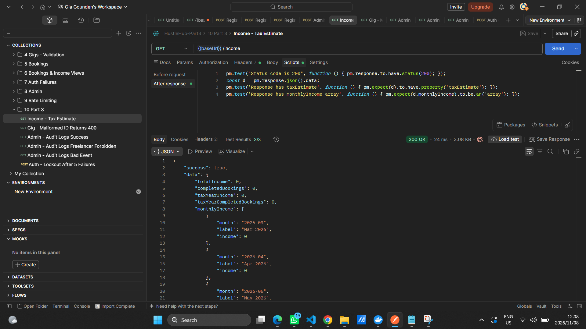

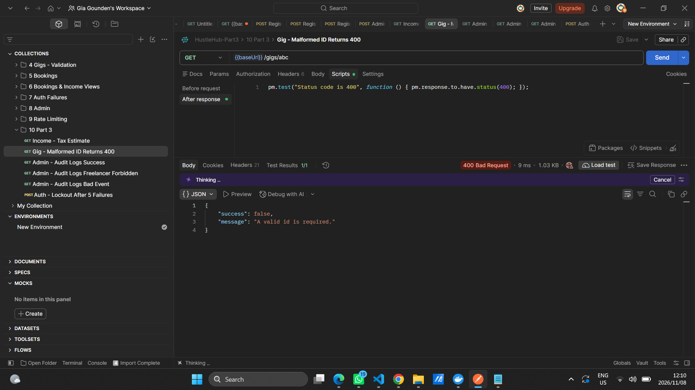

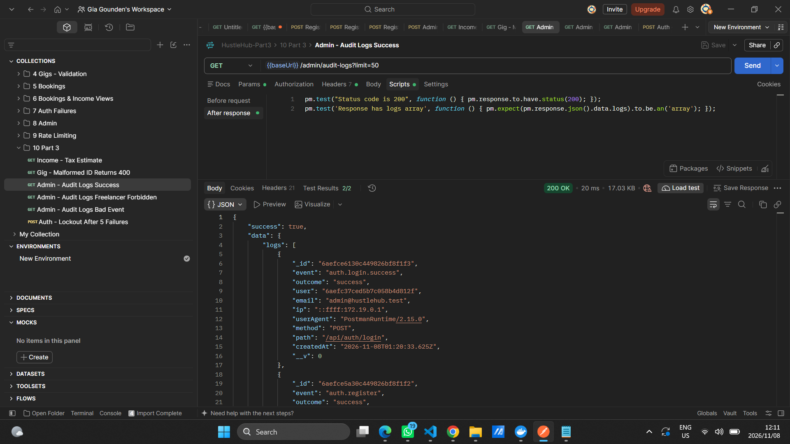

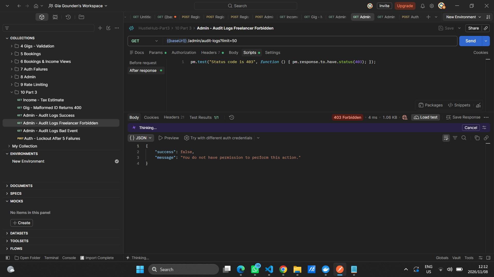

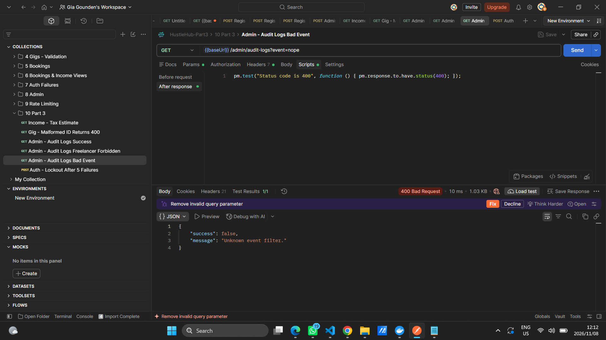

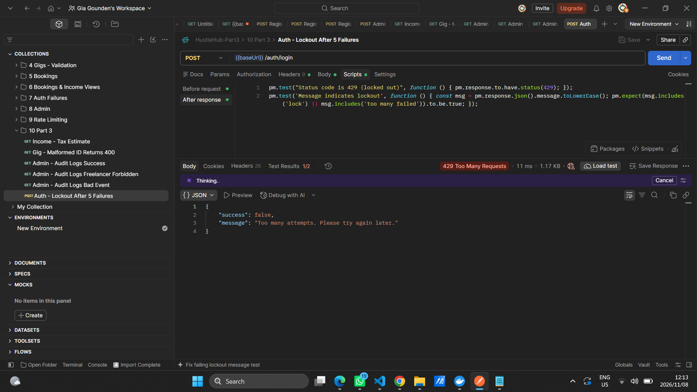

### Full collection — summary

All Part 2 tests were re-run against the same Docker Compose stack. Setup, auth, gigs, ownership, validation, bookings, income views, JWT failures, admin endpoints and rate limiting all passed. The full run had 104 requests, 0 failures, 145 assertions, 0 failures.

### Newman run summary

| Metric | Value |
|---|---|
| Iterations | 1 |
| Requests executed | 104 |
| Requests failed | 0 |
| Test scripts | 72 |
| Prerequest scripts | 6 |
| Assertions | 145 |
| Assertions failed | 0 |
| Total duration | 9.8s |

The full terminal output from the run is saved at `backend/postman/newman-output-part3.txt`.

### Newman Run — Terminal Output

The full Newman run was captured in screenshots.

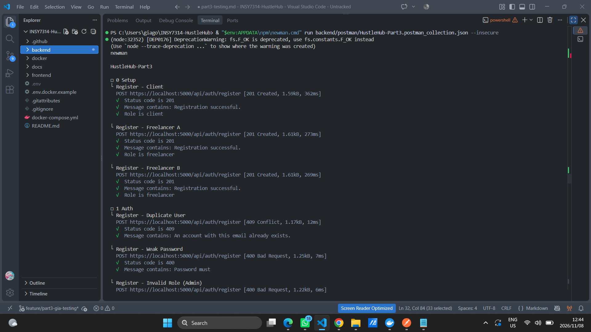

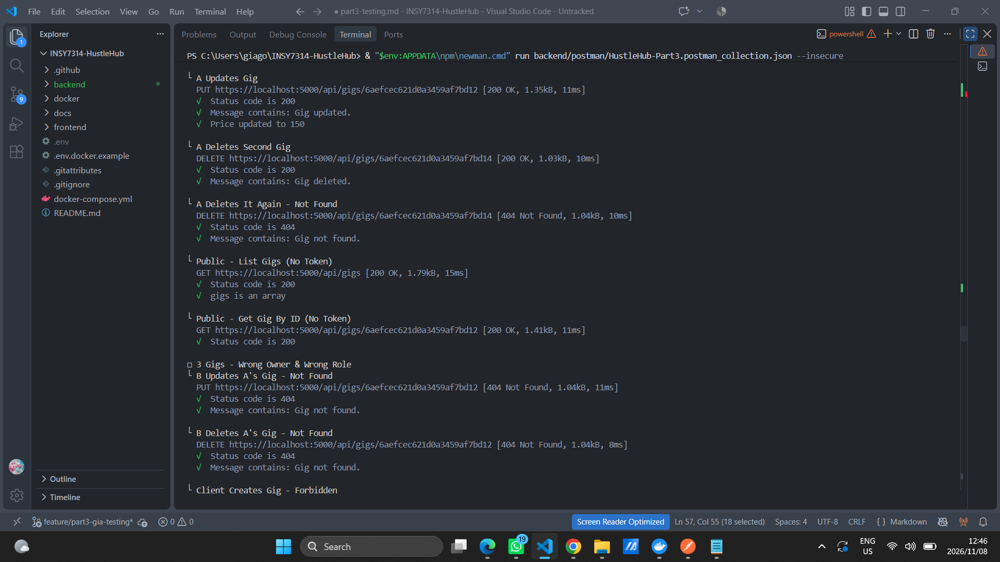

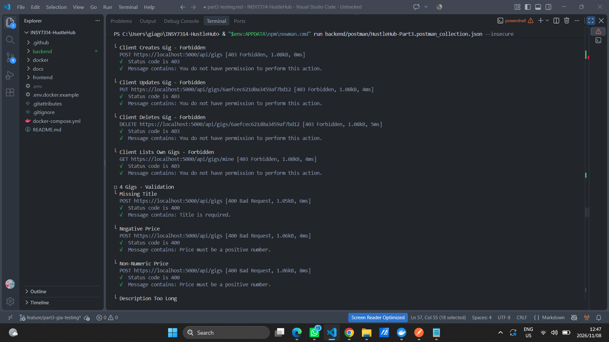

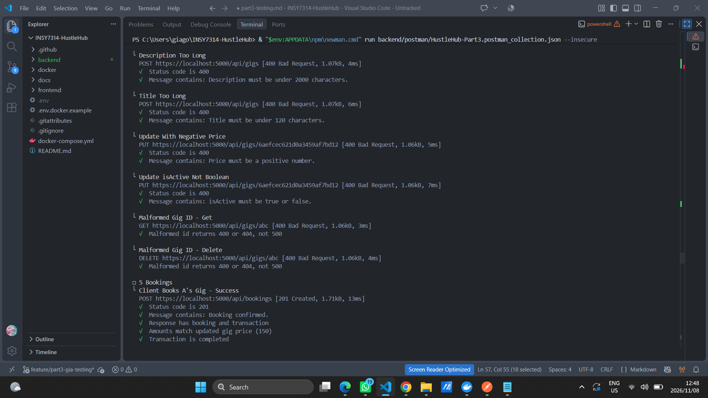

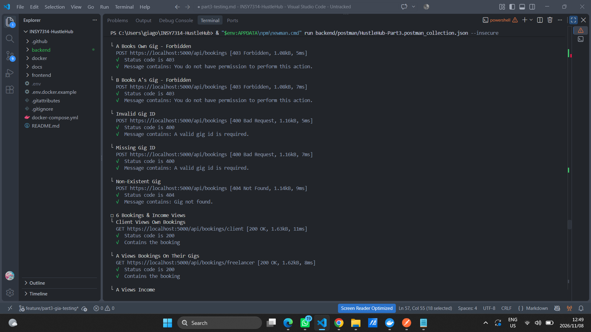

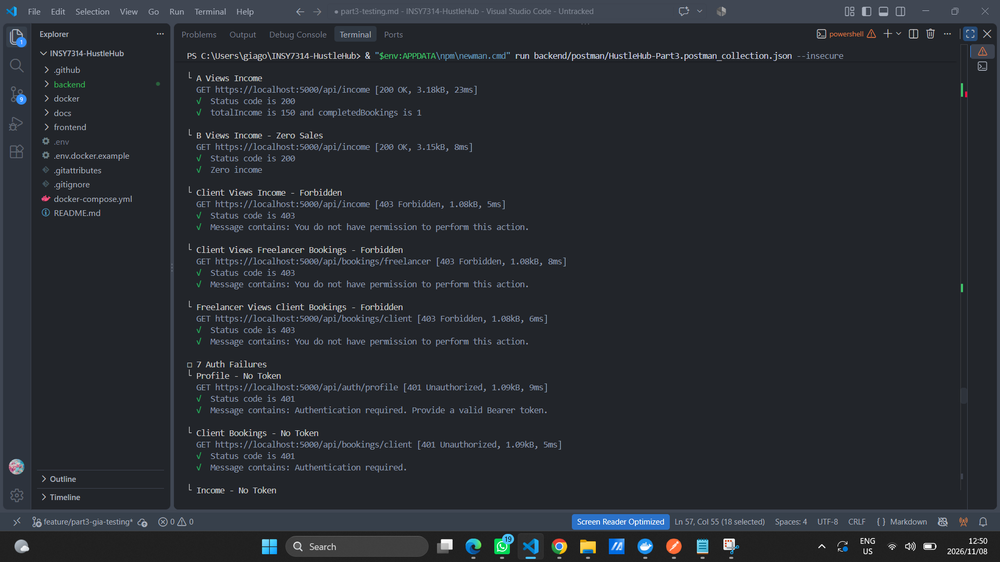

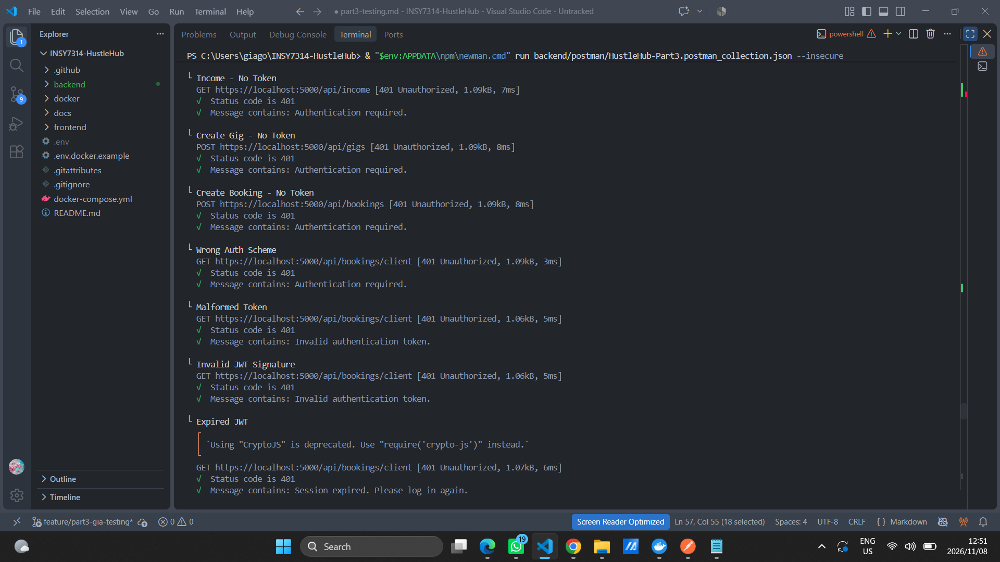

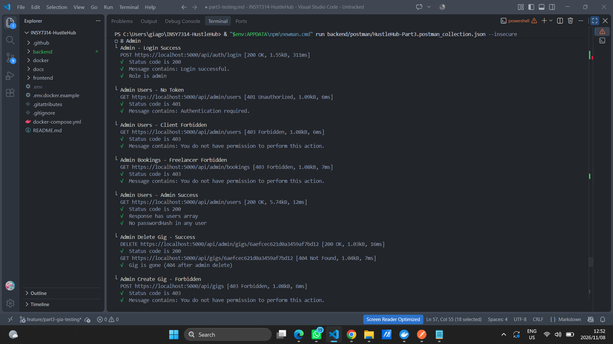

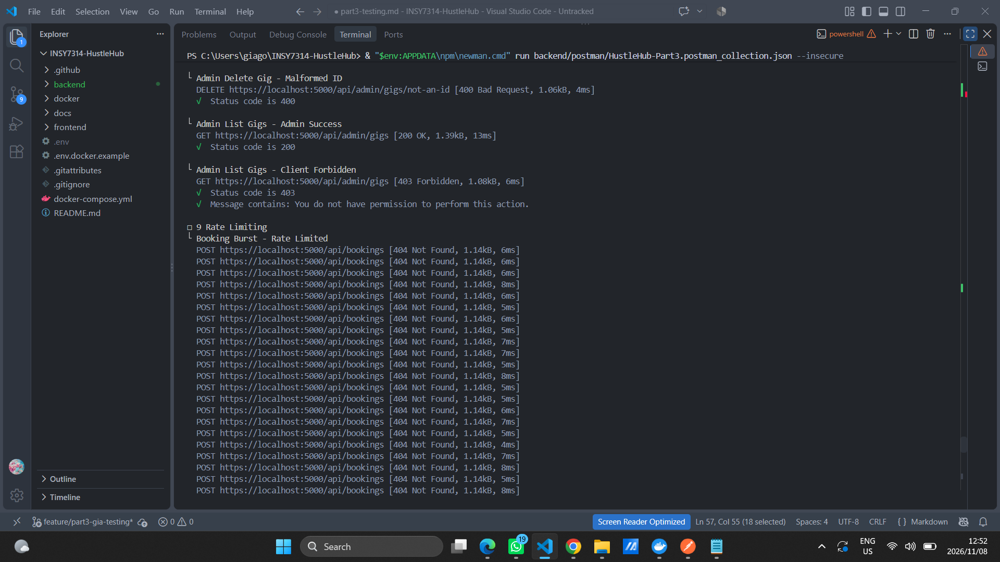

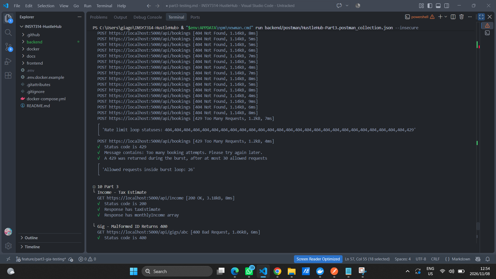

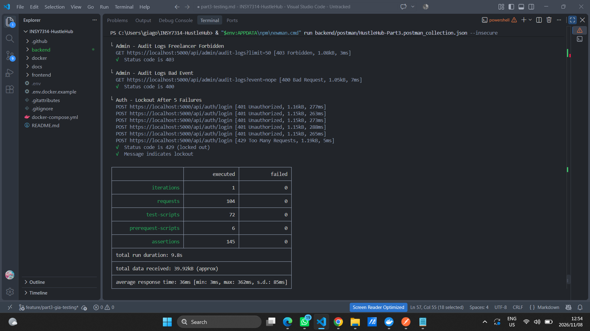

### Notes on each Part 3 test

**Income tax estimate** - the income endpoint was extended to include the freelancer's year-to-date tax estimate (based on the SA tax year) and a monthly income series. The test checks that both fields are present in the response, and the existing Part 2 income test still passes alongside it (total income 150, completed bookings 1).

**Malformed gig id fix** - in Part 2, GET or DELETE on a malformed id (like `/api/gigs/abc`) caused Mongoose to throw an uncaught error and return 500. Part 3 adds validation so those requests now return 400 Bad Request. The test specifically checks for 400, not a range, because the fix is deterministic.

**Audit logs (admin / freelancer / bad event)** - the audit log endpoint is protected by RBAC. An admin gets a 200 with a `logs` array. A freelancer gets a 403. An admin sending an invalid `event` query param gets a 400 with a validation message. This proves the RBAC layer wraps the endpoint (admin-only) and that input validation runs before the query hits the database.

**Account lockout** - after 5 consecutive failed login attempts for the same email, the account is locked and further login attempts return 429 with the message "Too many failed login attempts. Please try again later." Importantly, the 6th attempt in the test uses the **correct** password - so the 429 proves the lockout is active against valid credentials, not just against wrong passwords. The test fires the 5 wrong attempts in the pre-request script, then sends the real request with the correct password, and checks the response status and message.

## Security-Specific Notes

The Part 3 additions are all security-adjacent features, so a lot of the testing was about confirming that they actually block or log the right things, not just that they return a 200:

- **Lockout prevents credential stuffing.** After 5 failed attempts the account is locked regardless of whether the next attempt has the right password. The 429 response does not distinguish between "wrong password on a locked account" and "correct password on a locked account" - it's the same message either way, which prevents attackers from using the lockout state as an oracle to test whether they've guessed the password correctly.
- **Audit logs are RBAC-protected.** Only admins can read them. Freelancers get a 403. The endpoint also validates the `event` query parameter - an unrecognised event returns 400 before any database query runs, which prevents log enumeration by an attacker trying to guess valid event names.
- **The malformed id fix reduces error surface.** In Part 2 a malformed id returned 500 - which meant the error handler was treating an expected input-validation problem as an unexpected server error. Part 3 fixes this by validating the ObjectId format before the Mongoose query runs, so the API returns 400 as a client error, not a server error. This is both more correct semantically and reduces noise in server logs and monitoring.
- **The income tax estimate returns data the user already has access to.** The endpoint is already protected by RBAC (freelancer only) and scoped to the authenticated user (the freelancer can only see their own income and tax estimate, not other freelancers'). The new fields don't widen the attack surface.

## Issues Found

No new issues were found in Part 3. The two issues flagged in Part 2 are both resolved:

- **Malformed gig ids now return 400** instead of 500. The test for this was tightened from "400 or 404" to "400" and passes.
- **Price of 0 is still accepted.** This was noted in Part 2 as a minor mismatch between the error message ("Price must be a positive number") and the schema rule (`min: 0`). It's not a test failure - no test exercises price 0 explicitly - but it's still there. If the team wants to enforce strictly positive prices, the schema needs `min: 0.01` or similar, and the error message stays the same.

## Testing Method

Part 3 testing used the same Postman collection (`HustleHub-Part3.postman_collection.json`) as Part 2, extended with six new requests in a "10 Part 3" folder at the end of the collection. The collection was run against the Docker Compose stack (backend, frontend and MongoDB in containers) rather than against a locally running `npm run dev` backend, so the tests exercise the same environment the final deployment uses.

Before each full Newman run the backend was restarted with `docker compose restart backend`, which resets the rate limit and account lockout counters so the run starts from a clean state. The `--insecure` flag was passed to Newman because the backend uses a self-signed HTTPS certificate in the container.

The command used was:
newman run backend/postman/HustleHub-Part3.postman_collection.json --insecure

Test accounts and gig ids are stored as collection variables during the run (same as Part 2), so requests can depend on each other without anything being typed in by hand. The lockout test in particular relies on this - the pre-request script uses the `runId` variable set during setup to construct the same email that was registered earlier in the run, so it locks the correct account. The setup and rate limiting tests are kept in the same positions as Part 2 (setup first, rate limiting second-to-last, Part 3 tests last) so the lockout test doesn't interfere with the earlier login tests.